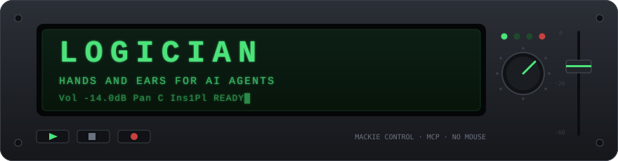

<div align="center">



# Logician

**Give your AI agent hands and ears in Logic Pro.**

[](#quick-start)
[](CHANGELOG.md)
[](LICENSE)

[See what it can do](#what-you-can-ask) · [Install](#quick-start) · [Agent guide](docs/AGENT-GUIDE.md)

</div>

Logician connects your AI agent to Apple Logic Pro. Your agent can listen to an actual render of your song, inspect its tracks and plugins, suggest an edit, and listen again after making the changes you approve. It's open source and runs on your Mac.

**Listen → understand → propose → approve → change → listen again.**

The conversation is grounded in your actual session: the agent works with the sound and project itself. To listen, it needs a client that forwards audio and an AI model that can understand it. Logician supplies the audio and controls.

**You direct the session.** Ask your agent to propose edits first and require approval in your client before it changes the project. Logician does not add its own approval dialog. [Start installing below](#quick-start).

## Quick start

**You need:** macOS 14.5 or later, Logic Pro, and Apple's command-line tools with **Swift 6 or newer**. Open Terminal (⌘-Space, type “Terminal”) and run `swift --version` to check. If the tools are missing, run `xcode-select --install`; if Swift is older than 6, update the command-line tools first.

### 1. Install

With Homebrew already installed, paste this into Terminal:

```bash
brew install bannebanning/logician/logician
```

This builds Logician on your Mac; build time varies. **No Homebrew?** Follow the [installer or manual-build instructions](docs/INSTALL.md#1-build-the-app).

### 2. Connect your AI and Logic

Follow the [instructions for your AI client](docs/INSTALL.md#2-connect-it-to-your-ai), then restart the client. MCP is the connection it uses to talk to Logician.

Ask the agent to run `logic_health` once to create the MIDI ports. In Logic, open **Logic Pro → Control Surfaces → Setup… → New ▾ → Install…**. Add **Mackie Control** and set both **Input Port** and **Output Port** to **`Logic MCP MCU`**. Grant Accessibility to your AI client or terminal app in macOS System Settings when prompted. [Detailed steps and troubleshooting](docs/INSTALL.md#3-let-logic-see-it).

### 3. Try a first listen

Open a duplicate of a project for your first session, then ask:

> “Run the health check, then bounce bars 1–4. Tell me whether you received real audio and what you hear. Propose any edits and wait for my approval.”

A healthy Logic connection does not prove that audio reaches the model. If the agent cannot receive audio, it can still inspect and control the project, but should say it cannot listen. For setup problems, run `logician doctor`; review its redacted report before sharing it.

## What you can ask

- **“Listen to the chorus. Why is the vocal getting lost?”** An audio-capable agent can listen, inspect the vocal chain and mix, and suggest changes for you to judge.
- **“Try that compressor setting and let me hear before and after.”** Logician can change a parameter, report its readback from Logic and return both renders for comparison.
- **“Move the late note in bar 17, keeping the rest of the performance.”** The agent can inspect and edit individual MIDI events.
- **“Export chorus stems for the band.”** Logician can render tracks over the same bar range and report alignment and isolation checks.

It also supports levels, pan, routing, sends, plugins, regions, MIDI composition, automation and project management. The [Agent guide](docs/AGENT-GUIDE.md) describes each tool's capabilities, refusals and limitations.

## Hearing, changes and verification

**Hearing means rendered audio**, such as a bounce of a chorus, a track render or a before/after comparison. Logician returns local audio files and MCP audio content. Long renders may include only a short listening window; the agent can request another section. It does not itself judge the music.

Both the **client's audio forwarding** and the **model's audio understanding** matter. The maintainer has verified listening in interactive Antigravity sessions; Antigravity's non-interactive `agy --print` was observed to drop audio. Other clients and modes need their own listening check. See [client setup](docs/INSTALL.md#2-connect-it-to-your-ai).

Logician reports what it could confirm from Logic's displays and controls. Verification has a specific scope for each tool; some results are partial or unverified, and a parameter readback does not establish that a mix sounds better. Rollback is attempted only where supported. Complex edits may need Logic's Undo, and some changes cannot be automatically undone.

Approval is handled by your conversation and client permissions, so configure those before enabling changes. Save only occurs when a requested operation allows it. Use a duplicate for experiments, and avoid simultaneous edits in Logic while the agent is working.

## Local operation and privacy

Logician runs locally, with no telemetry, account or internet service of its own. **Your AI client may send rendered audio, project details and file paths to its model provider.** Check that client's settings and privacy terms before using confidential or unreleased material. See [Security](SECURITY.md).

Bounces and previews are stored in `~/Library/Application Support/Logician/captures`. New captures trigger cleanup of older audio under a retention policy; copy files you want to keep elsewhere.

## Beta and compatibility

This is **v1.0.0-beta.1**. The repository records live checks on **Logic Pro 12.3.1 with the English interface**. Automated tests exercise behavior without operating Logic; they cannot establish compatibility with every session, plugin or audio setup.

- Other Logic versions and languages are **best-effort**.
- Tempo curves are read as steps because Logic does not expose their shape.
- Recorded automation targets tracks, not Stereo Out, auxes or buses; their static mix and plugin parameters remain controllable.
- Missing or ambiguous evidence can cause an operation to refuse. Logic updates can still change behavior, and this beta cannot guarantee safe recovery from every failure.

Please report regressions with the reviewed, redacted output from `logician doctor`. [Installation and troubleshooting](docs/INSTALL.md) · [Technical and agent reference](docs/AGENT-GUIDE.md)

---

<div align="center">
<sub>Built by <a href="https://www.linkedin.com/in/alexander-banning-663788205/"><b>Alexander Banning</b></a> · Released under the <a href="LICENSE">MIT license</a> · <a href="CONTRIBUTING.md">Contributing</a> · <a href="SECURITY.md">Security</a></sub>

<sub>Not affiliated with, endorsed by or sponsored by Apple Inc. or LOUD Audio, LLC. Logic Pro and Mackie Control are trademarks of their respective owners — see <a href="NOTICE.md">NOTICE.md</a>.</sub>
</div>
